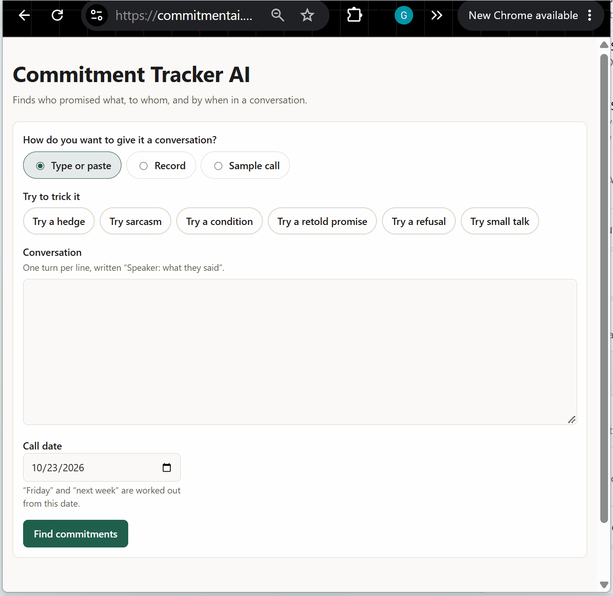

# Commitment Tracker AI

Commitment Tracker AI reads a conversation transcript and returns the commitments in it: who promised what, to
whom, and by when. Every statement gets one of eight labels, so a firm promise is kept apart from a hedge, a
request, a promise someone else made, or a refusal.



```http
POST /analyze
{
  "call_date": "2026-10-21",
  "transcript": [
    {"speaker": "buyer",  "text": "Could you send the updated SOW before Thursday?"},
    {"speaker": "seller", "text": "Yes, I will get it to you tomorrow morning."}
  ]
}
```

```json
{
  "spans": [
    {"turn_index": 0, "label": "REQUEST", "owner": null, "action": "send the updated SOW",
     "due": {"raw": "before Thursday", "resolved": "2026-10-21", "precision": "day"}, "in_ledger": false},
    {"turn_index": 1, "label": "COMMITMENT", "owner": "seller", "recipient": "buyer",
     "action": "send the updated SOW", "quote": "Yes, I will get it to you tomorrow morning.",
     "due": {"raw": "tomorrow morning", "resolved": "2026-10-22", "precision": "day"},
     "confidence": 0.93, "in_ledger": true, "soft": false}
  ],
  "metadata": {"model": "claude-haiku-5-5", "attempts": 1, "dropped_quotes": 0, "latency_ms": 5778,
               "cost_usd": 0.0009}
}
```

The response is abridged; every span also carries `recipient`, `condition`, `quote`, `rationale` and
`ambiguous`, and the metadata carries token counts and the model that answered.

Part 1 is the text API and an evaluation harness. Part 2 adds audio, a web demo and the AWS deployment
([spec](docs/spec.md), [Part 2 plan](docs/plans/part-2-audio-and-deploy.md)).

## The demo

The site at `commitmentai.g26work.com` takes a conversation three ways and shows the same result for each:

- **Type or paste** one `Speaker: text` line per turn. Six prompt chips ("Try a hedge", "Try sarcasm") fill in
  examples that invite a mistake.
- **Record** up to 60 seconds. The notice says what happens to the audio before the browser asks for the
  microphone, a countdown stops the recording by itself, and the optional speaker names are applied to the first
  and second voice heard. If the voices come back matched to the wrong names, one button swaps them.
- **Sample call**, one of four scripted two-person calls read by synthetic voices, playable before they are analysed.

The result is a ledger of commitments (owner to recipient, action, the due phrase with its resolved date, the
condition of a conditional, a soft marker on a hedged one, the quote and the reason), a "Not a commitment" panel for
the near misses, and the transcript with each quote marked. Each result takes a thumbs-up or thumbs-down. Ticking the
box keeps the transcript for up to 90 days to improve the labels; the votes themselves hold no text. Every label has
a name, a symbol and a line style as well as a colour, the status line is announced to screen readers, and the
layout works on a phone.

## Architecture

```text
browser ── POST /uploads ─────────► API Lambda (FastAPI on Mangum) ── presigned form
        ── file, straight to S3 ──► audio bucket (uploads/, deleted after transcription)
        ── POST /jobs ────────────► API Lambda ── job in DynamoDB, Amazon Transcribe batch job started
        ── GET /jobs/{id}, 1/s ───► API Lambda ── reads the job

Transcribe finishes ── EventBridge ──► worker Lambda ── reads the output, names the speakers,
                                       deletes the audio, the output and the Transcribe job,
                                       runs the extractor, records the stage times
```

- **Audio never passes through the API.** It goes to S3 by a presigned form capped at 60 s of 16 kHz mono WAV, which
  the browser writes itself, and the server checks the header again.
- **A job is the unit of work.** Its id is a hash of the audio (or the turns), the call date and the speaker names,
  so a retried upload returns the existing job. It lives in DynamoDB for an hour, and a transcript is kept nowhere
  else.
- **Text goes through the same flow** (`POST /jobs` with a `transcript`), so one status line, one results view and
  one feedback path serve all three modes. `POST /analyze` is unchanged for API clients.
- **The model behind the API is Claude Haiku 5.5** on the deployed stack; the backend's default stays Opus.
- Decisions and their reasons are in [docs/decisions](docs/decisions): batch transcription, the job resource,
  Mangum on a zip, CDK in TypeScript, Polly sample clips and a separate AWS account.

### Latency

Amazon Transcribe batch jobs took 15.4 s at the median (15.8 s at p95) for a 59 s two-voice clip, measured over ten
jobs in `us-east-2` ([ADR 0002](docs/decisions/0002-batch-transcription.md)). With the model call on top, a full-length
recording should take about 17 to 19 seconds end to end, which misses the 10 second target. A text job takes a few
seconds. Only transcribing the recording live, while it is spoken, could meet 10 seconds for audio. The
deployed numbers come from `backend/scripts/measure_latency.py` (see [docs/deploying.md](docs/deploying.md)).

## How it works

The model proposes and code decides. One request per transcript goes to Claude with the output schema enforced
as structured output. The reply is then validated, and anything that fails validation gets one retry with the
errors attached. Every quote must appear word for word in its turn, and spans with a quote that doesn't are
dropped and counted. Due dates are resolved by tested code from the call date, never by the model: "end of next
week" on Wednesday 21 October is Friday 30 October. The design and its sources are in
[docs/plans/part-1-extraction-call.md](docs/plans/part-1-extraction-call.md).

The API never logs transcript text, and error responses never echo it back.

## Labels

COMMITMENT, HEDGED and CONDITIONAL create a ledger entry; the other five are near misses.

| Label | Meaning | Example | Ledger |
| --- | --- | --- | --- |
| COMMITMENT | The speaker binds themselves or their team to a specific action | "I'll send the pricing by Friday." | Yes |
| HEDGED | An action is named but the obligation is softened | "I'll try to get that over this week." | Yes, marked soft |
| CONDITIONAL | A commitment that depends on a stated condition | "If legal signs off, we'll ship Monday." | Yes, with the condition |
| SUGGESTION | An idea with no owner bound to it | "We should probably revisit pricing." | No |
| REQUEST | Asks the other party to act | "Can you send the deck?" | No |
| REPORTED | Someone else's promise, retold | "Sarah said she'd send it." | No |
| REFUSAL | Declines or withholds a commitment | "I can't promise the 15th." | No |
| NONE | Facts, past events, policy, small talk | "Our SLA is four hours." | No |

A reply such as "Sure, I'll do it" is a COMMITMENT when the preceding turn asked for something, so each turn is
judged with the turn before it.

## Setup

You need Python 3.12 or later, [uv](https://docs.astral.sh/uv/), and Anthropic credentials. Either sign in with
the Anthropic CLI (`ant auth login`), or set `ANTHROPIC_API_KEY` in the environment or in `backend/.env`, which is
git-ignored.

```bash
cd backend
uv sync
```

## Run the API

```bash
cd backend
uv run uvicorn commitment_tracker.api.app:app --port 8000
```

```bash
curl -X POST http://localhost:8000/analyze -H "content-type: application/json" -d '{"call_date": "2026-10-21", "transcript": [{"speaker": "seller", "text": "I will send the pricing by Friday."}]}'
```

`GET /health` reports the model and prompt version. A request is limited to 200 turns and 20,000 characters.
Errors share one body, `{"error": {"code", "message", "details"}}`:

| Status | Code | When |
| --- | --- | --- |
| 422 | `validation_error` | The request is malformed or too large; `details` names the fields |
| 422 | `model_refused` | The model declined the transcript |
| 502 | `model_unavailable` | The model API failed after retries, or no credentials are set |
| 502 | `model_output_invalid` | The model's output failed validation twice |
| 429 | `rate_limited` | Too many requests from this address; see `Retry-After` |
| 503 | `daily_budget_exhausted` | The day's spending cap is reached; `Retry-After` is the time to UTC midnight |

The demo's job flow adds these routes (see [openapi.json](openapi.json) for the shapes):

| Route | Does |
| --- | --- |
| `POST /uploads` | Returns a presigned S3 form for one recording of at most 60 s |
| `POST /jobs` | Starts a job from an `upload_id`, a `sample_id` or a `transcript`, with the call date and speaker names |
| `GET /jobs/{id}` | The status (`uploaded`, `transcribing`, `analyzing`, `done`, `failed`), then the transcript, the analysis and the time spent in each stage |
| `GET /samples` | The sample clips |
| `POST /feedback` | A thumbs-up or thumbs-down on one span, with the consent to keep the transcript |

Their errors add `audio_too_long` and `audio_invalid` (422), `upload_not_found`, `sample_not_found`,
`job_not_found` and `span_not_found` (404), `job_not_finished` (409) and `jobs_unavailable` and
`uploads_unavailable` (503). The job routes answer 503 until a bucket and tables are configured, so a local run with
only an API key serves `/analyze` as before.

The OpenAPI schema is committed as [openapi.json](openapi.json); regenerate it with `uv run export-openapi` after
changing a model or route. A test fails when it is out of date.

Settings come from the environment or `backend/.env`:

| Variable | Default | Meaning |
| --- | --- | --- |
| `EXTRACTOR_MODEL` | `claude-opus-5-5` | Model id |
| `EXTRACTOR_EFFORT` | `medium` | `low`, `medium`, `high`, `xhigh` or `max` |
| `EXTRACTOR_MAX_TOKENS` | `16000` | Output limit per call, thinking included |
| `PROMPT_VERSION` | `v1` | File in `backend/src/commitment_tracker/extractor/prompts/` |
| `MODEL_TIMEOUT_SECONDS` | `60` | Per request; the SDK retries twice on rate limits and server errors |
| `ANTHROPIC_API_KEY` | unset | Optional when signed in with `ant auth login` |
| `ANTHROPIC_API_KEY_PARAMETER` | unset | On Lambda: the SSM SecureString holding the key |
| `AUDIO_BUCKET`, `JOBS_TABLE`, `GUARDRAILS_TABLE`, `FEEDBACK_TABLE` | unset | Turn on uploads, jobs, rate limits and the spend cap, and feedback |
| `WORKER_FUNCTION_NAME` | unset | The worker Lambda that text jobs are handed to |
| `DAILY_BUDGET_USD` | `5` | The daily spend cap the API enforces |

## Run the site

```bash
bun install
NEXT_PUBLIC_API_BASE_URL=http://localhost:8000 bun run --cwd frontend dev
```

The site is a Next.js 16 static export (`bun run --cwd frontend build` writes `frontend/out`). Its client is typed
from `openapi.json`: after an API change run `uv run export-openapi` in `backend/`, then
`bun run --cwd frontend gen:api`; CI fails when either is stale. The API's CORS allows `http://localhost:3000`.

## Deploy

Two CDK stacks in `infra/` put it in its own AWS account: the API, bucket, tables, Transcribe rule, budget kill
switch and alarms, and the Amplify site. Deploying is yours to run; the steps, the one-time account setup and the
reset commands are in [docs/deploying.md](docs/deploying.md).

### Guardrails and costs

| Limit | Value |
| --- | --- |
| Per address | 20 uploads and 20 jobs an hour, 30 `/analyze` calls an hour, 120 votes an hour, 120 polls a minute |
| Daily cap, enforced by the API | $5 (`-c dailyBudgetUsd`), counting Transcribe and the model |
| Monthly AWS budget | $30 (`-c monthlyBudgetUsd`); at 100% it stops both Lambda functions |

A recording costs about $0.025 (almost all of it Transcribe) and a text job about $0.001. Audio is deleted from S3
as soon as it is transcribed, with a one-day lifecycle rule behind that, and the logs carry ids, counts and timings,
never transcript text.

## Evaluate

```bash
cd backend
uv run eval --model claude-haiku-5-5 --prompt v1
```

The runner sends each item in [backend/eval/data/dev.jsonl](backend/eval/data/dev.jsonl) through the extractor,
four at a time (`--concurrency`), and writes a JSON report and a markdown summary to `backend/eval/reports/`. The
report covers:

- precision and recall per label, and a confusion matrix
- ledger F1: the three ledger labels against everything else
- accuracy of owner, action and resolved due date on ledger spans
- quote-check failures, retries, p50 and p95 latency, and total cost

Items tagged `ambiguous`, such as sarcasm, are listed separately and left out of the headline numbers. The command
exits 1 if any item failed, after writing the report.

Each call costs money. Responses are cached in `backend/eval/.cache/` by transcript, model, prompt text and effort,
so a rerun only calls the model for what changed. The cache stores finished responses, including resolved dates:
after changing the extractor or the date resolver, run with `--no-cache` or delete the cache folder.

### Results

| Model | Prompt | Dataset | Ledger F1 | Label accuracy | Field accuracy (owner / action / due) | p50 / p95 latency | Cost |
| --- | --- | --- | --- | --- | --- | --- | --- |
| claude-haiku-5-5, medium effort | v1 | 24 seed items | 1.000 | 1.000 | 13/13, 11/11, 13/13 | 1.5 s / 2.6 s | $0.0046 |

The 24 seed items are the development set. The prompt was written with them in view, so this row confirms the
pipeline end to end rather than measuring accuracy. Accuracy will be measured on a held-out set of 150 items,
which comes later with the comparison across models.

## Develop

Tests make no network calls. In `backend/`:

```bash
uv run pytest
uv run ruff check . && uv run ruff format --check .
uv run mypy
```

At the repository root, after `bun install`:

```bash
bun run lint
bun run typecheck
bun run test
```

`bun run --cwd frontend e2e` also builds the site and runs the Playwright test on Chromium. CI runs all of it
([.github/workflows/ci.yml](.github/workflows/ci.yml)).

The code lives in `backend/src/commitment_tracker/`:

- `schemas.py`: the request and response models
- `extractor/`: the prompt files, the Anthropic adapter, validation and retry, and the date resolver
- `api/`: the FastAPI app
- `evaluation/`: the dataset loader, matching, metrics, cache and reports
- `transcription/`: the Transcribe adapter and the mapping from its output to timed turns
- `jobs/`: the job record and its stores, the service, the worker, uploads, WAV checks and the sample catalog
- `guardrails/`: rate limits, the daily spend cap and the CloudWatch metric
- `feedback/`: votes and consented transcripts
- `lambda_handlers.py`: the Lambda entry points

`frontend/` is the site, `infra/` the CDK app, and `backend/scripts/` holds the Polly sample script and the latency
and audio-deleted checks. A test enforces the import rules between the Python packages. Conventions for contributors and coding agents are in
[CLAUDE.md](CLAUDE.md).

Versions and the changelog come from release-please, driven by Conventional Commit types; never bump a version by
hand. See [docs/releasing.md](docs/releasing.md).

## License

MIT; see [LICENSE](LICENSE).
