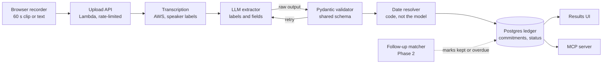

# Commitment Tracker AI — Project Spec

Oct 21, 2026 · Glenn McDonald

## Overview

Commitment Tracker AI turns a short audio clip into a verified list of commitments: who promised what, to whom, and by when. It later checks whether each one was kept. The framing is reconciliation, the same discipline as matching trades to broker confirms, applied to verbal promises.

It is a portfolio project for senior backend roles. It should prove three things: a sound pipeline, AI output that is validated rather than trusted, and accuracy that is measured rather than claimed.

**Goals**

- A live demo: record up to 60 seconds and get commitments back in under 10 seconds (target).
- Separate firm commitments from hedges, conditionals, suggestions, requests, reported speech and refusals.
- Publish an evaluation: precision and recall per category on 200 labeled utterances, plus cost and latency per model.
- Expose the ledger through a REST API and an MCP server.

**Non-goals for v1**

- Live transcription during a call in progress.
- Languages other than English.
- Production CRM integrations.
- Storing visitors' audio.

## Demo experience

A visitor should see the system catch a real promise and refuse a fake one within a minute of landing.

1. The visitor records a clip, plays a sample two-person clip, or types text. Text mode covers people without a microphone.
2. They can set the call date and speaker names, so relative dates and owners resolve correctly.
3. A status line shows each stage: uploading, transcribing, analyzing.
4. The transcript appears with each classified span highlighted by category.
5. Each commitment gets a card: owner, recipient, action, due date (raw words and resolved calendar date), confidence, and the quote with its timestamp.
6. A **Not a commitment** panel lists near misses with a one-line reason, such as "request, not a promise" or "reported speech."
7. Thumbs-up and thumbs-down on each label collect corrections, which become candidate test cases with the visitor's consent.

Prompt chips invite visitors to try to trick it ("Try a hedge," "Try sarcasm"). In Phase 2, a ledger view lists every commitment with status Open, Kept or Overdue.

## Commitment schema and categories

Every classified span gets exactly one label. Only the first three labels create a ledger entry; the rest appear in the near-miss panel.

| Label | Definition | Example | Ledger |
| --- | --- | --- | --- |
| COMMITMENT | Speaker binds themselves or their team to a specific action | "I'll send the pricing by Friday." | Yes |
| HEDGED | An action is named but the obligation is softened or vague | "I'll try to get that over this week." | Yes, marked soft |
| CONDITIONAL | A commitment that depends on a stated condition | "If legal signs off, we'll ship Monday." | Yes, with condition |
| SUGGESTION | An idea or proposal with no owner bound to it | "We should probably revisit pricing." | No |
| REQUEST | Asks the other party to act | "Can you send the deck?" | No |
| REPORTED | A third party's promise, retold | "Sarah said she'd send it." | No, flagged |
| REFUSAL | Explicitly declines or withholds a commitment | "I can't promise the 15th." | No |
| NONE | Facts, past events, policy, small talk | "Our SLA is four hours." | No |

A request followed by "Sure, I'll do it" is a COMMITMENT by the person replying, so the extractor sees the preceding turn as context.

The model returns this shape, validated with a shared Pydantic model. Output that fails validation gets one retry with the error attached, then is logged as a failure.

```json
{
  "label": "COMMITMENT",
  "owner": "speaker_1",
  "recipient": "speaker_2",
  "action": "send revised pricing",
  "due": { "raw": "by Friday", "resolved": "2026-10-23", "precision": "day" },
  "condition": null,
  "confidence": 0.92,
  "quote": "I'll send you the revised pricing by Friday.",
  "span_ms": [41200, 44100],
  "rationale": "First-person future action with a specific deadline"
}
```

`due.precision` is one of day, week, event, vague or none. The model only returns `due.raw`; code fills in `resolved` from the call date, because date arithmetic is deterministic and easy to test.

## Architecture and pipeline

The backend, extractor and evaluation are Python (FastAPI, Pydantic v2, SQLAlchemy with PostgreSQL, uv, pytest), where the AI and evaluation tooling is strongest. The Part 2 frontend is Next.js, generating a typed client from the API's OpenAPI schema. Deployment reuses FlakeHunter's AWS CDK patterns, with the FastAPI app on Lambda.



The model only proposes; a schema check and deterministic code decide what lands in the ledger. The dashed box is Phase 2.

**Key design decisions**

- **Idempotent processing.** Each clip is keyed by a hash of its audio, so a retried upload never creates duplicate commitments.
- **Audio is transient.** It is uploaded to a short-lived storage location and deleted once transcription finishes.
- **Context window per span.** The extractor sees each utterance plus the preceding turn, which is enough for request-and-reply cases like #5 below.
- **Model behind an interface.** The extractor is one adapter, so swapping models for the comparison is a config change.

## Evaluation plan

The headline number is ledger F1 on a held-out set of 150 utterances: did the system put the right things in the ledger and keep the wrong things out?

**Dataset**

- 200 labeled items: about 22 per label, plus 20 multi-turn snippets where context decides the label.
- Split 50 development and 150 held-out test. Prompts are tuned only on development data.
- 30 test items are also recorded as audio, to measure how much transcription errors cost.
- Genuinely ambiguous items, such as sarcasm, are tagged and reported separately rather than forced into a label.

**Metrics**

- Precision and recall per label, plus a confusion matrix to show which labels get mixed up.
- Ledger F1: the three ledger labels against everything else.
- Field accuracy on ledger items: owner, action and resolved due date (exact match).
- Audio penalty: ledger F1 on the 30 audio items versus the same items as text.
- Cost per clip and p50/p95 latency.

**Model comparison.** Run the same test set through a small fast model, a large model, and a two-stage setup (small model screens, large model extracts only flagged spans). The README results table shows ledger F1, field accuracy, cost per clip and p95 latency for each.

**Regression gate.** The evaluation runs in GitHub Actions on every prompt or model change and fails the build if ledger F1 drops by more than 2 points.

## Labeled test utterances

These 24 items seed the development set and cover each label, including the traps that keyword matching would miss. Due dates assume a call on Wednesday, October 21, 2026, and the speaker is the seller unless noted.

| # | Utterance | Label | Expected fields and notes |
| --- | --- | --- | --- |
| 1 | I'll send you the revised pricing by Friday. | COMMITMENT | owner speaker; due 2026-10-23, day |
| 2 | We'll have the security review back to you by end of next week. | COMMITMENT | owner speaker's team; due 2026-10-30, day |
| 3 | Let me loop in our solutions engineer tomorrow. | COMMITMENT | due 2026-10-22, day |
| 4 | I'll get you a draft contract before your board meeting. | COMMITMENT | due tied to an event; precision event, resolved null |
| 5 | A: Can you resend the invoice? B: Sure, I'll do it this afternoon. | COMMITMENT | owner B, recipient A; due 2026-10-21; needs the prior turn |
| 6 | I'll send the recap, and Priya will set up the pilot account. | COMMITMENT ×2 | second owner Priya, assigned by the speaker |
| 7 | I'll try to get that over to you this week. | HEDGED | due week of 2026-10-19 |
| 8 | I should be able to have numbers for you Monday, fingers crossed. | HEDGED | due 2026-10-26, day |
| 9 | Hopefully we can get you a demo environment soon. | HEDGED | due vague |
| 10 | We'll circle back on that. | HEDGED | no specific action; due none |
| 11 | If legal signs off, we'll ship the integration on the 1st. | CONDITIONAL | condition legal sign-off; due 2026-11-01 |
| 12 | As long as procurement approves the PO, we can start onboarding next Tuesday. | CONDITIONAL | condition PO approval; due 2026-10-27 |
| 13 | We should probably revisit the pricing tiers at some point. | SUGGESTION | no owner bound |
| 14 | It might make sense to schedule a follow-up with your CFO. | SUGGESTION | proposal, not a promise |
| 15 | Can you send me the deck from today? | REQUEST | the listener would own it if they agree |
| 16 | Would you be able to share your current vendor list? | REQUEST | polite form of a request |
| 17 | Sarah said she'd send the SOC 2 report last week. | REPORTED | third party; possibly overdue, flag for review |
| 18 | Our CEO promised them a discount, I think. | REPORTED | contains "promised"; third party and uncertain |
| 19 | I can't promise we'll hit the 15th. | REFUSAL | contains "promise" but negated |
| 20 | I'm not going to commit to a date until engineering scopes it. | REFUSAL | explicit refusal with a reason |
| 21 | Last quarter I promised a rebate and we delivered it. | NONE | past and already fulfilled |
| 22 | Our standard SLA is a four-hour response time. | NONE | policy statement; arguable, tag ambiguous |
| 23 | Will do. (no prior turn) | NONE | contrast with #5: no context, no action |
| 24 | Oh sure, I'll definitely rewrite the whole platform by Friday. | NONE | sarcasm; tag ambiguous, report separately |

## Build plan, guardrails and open questions

The build runs text-first, so the evaluation harness exists before any audio work begins. Parts are sized for one person working with Claude Code.

1. **Text core (part 1).** Paste text in, get labels and the schema back. Seed the 50 development items and run the evaluation harness locally.
2. **Audio and demo site (part 2).** Next.js frontend with the browser recorder and results UI, transcription with speaker labels, and CDK deployment of the FastAPI backend to Lambda.
3. **Evaluation (part 3).** Complete the 150 test items and 30 audio recordings, run the model comparison, add the CI regression gate.
4. **Reconciliation (parts 4–5).** Ledger with status in PostgreSQL (SQLAlchemy and Alembic), a matcher against a simulated inbox and calendar, and the MCP server.
5. **Presentation.** README with the results table and failure analysis, plus a two-minute video.

**Guardrails for a public site**

- Clips capped at 60 seconds; audio deleted right after transcription.
- Transcripts kept only when the visitor opts in through the feedback buttons.
- A consent notice before recording, and no transcript text in logs.
- Per-client rate limiting and a daily budget kill switch, reusing the FlakeHunter patterns.

**Open questions**

- Decided: the demo offers both short browser recordings and a set of canned two-person sample clips, since speaker labeling may be weak on single-mic recordings.
- Decided: HEDGED items enter the ledger by default, marked soft.
- Deferred to Phase 2: whether follow-through uses a simulated inbox or a real Gmail and Calendar connection.
- Decided: the demo lives on a g26work.com subdomain, like FlakeHunter; commitmentai.g26work.com.
